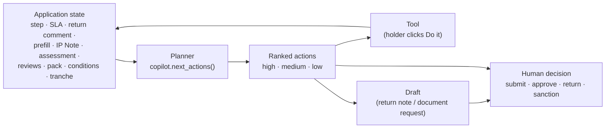

# Corporate LOS — AI, Agents and Governance

> Where AI is used in the LOS, what it is allowed to do, and the controls that keep it
> honest. For the overall design see [Architecture](LOS_ARCHITECTURE.md).

---

## 1. The stance

1. **The bank's people take every credit and workflow decision.** No AI and no copilot
   submits, approves, returns, rejects, sanctions or disburses.
2. **Figures come from the record.** Credit numbers are produced by deterministic engines,
   documents or the borrower master. AI text may quote them but never create, round or
   compute them; any AI text quoting a figure absent from its input is rejected.
3. **Everything is labelled.** Each value carries its basis, and AI output is tagged *AI*.
   Demo values stand in for bank models that are not connected and are tagged *Demo*.
4. **Everything is audited.** AI and copilot actions are events in the same audit trail as
   human decisions.

## 2. Where AI and automation are used

| Capability | Kind | Model | Guard |
|---|---|---|---|
| Credit assessment (CAM pipeline, M1–M7) | 7 agents + deterministic engines; LLM narrative for CAM sections | Configured provider | Existing CAM figure checks; sections checkpointed and versioned |
| Document prefill | Deterministic pattern extraction + cross-document corroboration | — | Source page and snippet for every value; nothing applied without the RM |
| Prefill AI fallback | LLM proposes fields the patterns missed | Configured provider (skipped on mock) | Accepted only if the value appears **verbatim on the cited page**; labelled *AI-proposed* |
| IP Note summary | LLM paragraph | Configured provider (skipped on mock) | Figure check against the note; rejected text is not stored |
| Committee brief | CAM interpretation of executive summary and recommendation | Configured provider | Figure check (`FinalCamService.interpret`) |
| Copilot next actions | **Rule-based planner** over the application state | — | Deterministic, explainable (each action says *why*) |
| Copilot tasks | Runs a whitelisted service operation | — | Holder only, holder's permissions, audited |
| Copilot drafts | Deterministic assembly from the record | — | Editable; nothing is sent |
| Copilot Q&A | LLM answer from the application record | Configured provider | Figure check; rejected or mock → matching record lines instead |
| MIS | Deterministic aggregation of the audit trail | — | — |

The LLM provider is chosen in `config/llm_providers.yaml` (`active_provider`). Tests and
offline demos use `mock`, which disables every AI path; each feature then falls back to its
deterministic behaviour and says so in the UI.

## 3. The copilot — an agent with a short leash

**Planner.** `next_actions(state)` reads a state built by `LosService._copilot_state` and
returns ranked proposals, each with a title, a *why* and optionally a tool or a draft.
Examples:

| Situation | Proposal |
|---|---|
| SLA breached | *SLA breached at …*: complete today or escalate (high) |
| Returned | *Address the return comment* quoting it (high) |
| Sourcing, documents on file, no prefill | *Run the document prefill* (tool) |
| Prefill run, high-confidence values pending | *Accept N high-confidence values* (tool) |
| Fields not found | *Request missing items from the borrower* (draft) |
| IP Note step, no note | *Generate the IP Note* (tool) |
| Risk Maker, no assessment | *Run the credit assessment* (tool) |
| Committee step, no brief | *Generate the AI committee brief* (tool) |
| Unresolved high-severity risks | listed, with *Draft return note* |
| Post Sanction, letter not issued | *Issue the sanction letter* (tool) |
| Disbursement, items missing | *Complete N checklist items* |
| Nothing blocking | *Ready — submit / approve / decide this step*. *The decision is yours.* |

Users who do not hold the step see *This step is with …*.

**Tools** (`copilot.TOOLS`): `run_prefill`, `accept_high_confidence`, `generate_ip_note`,
`start_assessment`, `committee_brief`, `issue_sanction_letter`. `copilot_run` checks that
the caller holds the step, writes a `copilot_action` event, then calls the same service
method a person would, with that person's permissions. There is no tool for a workflow
decision, and an unknown tool is refused.

**Q&A.** `copilot_ask` builds a compact record of the application (summary, facility,
accepted sourcing values, IP Note pre-screen, credit assessment, decision pack, sanctions,
conditions, disbursement, comments) and asks the LLM to answer **only** from it, quoting
figures exactly. If the answer quotes a figure that is not in the record, or the model fails,
or the provider is `mock`, the copilot shows the record lines that best match the
question and explains why. Each question and answer is stored on the application and
audited.

**Digest.** The dashboard lists the signed-in user's queue, SLA breaches first, with the top
proposal for each item.

## 4. The figure check

Every AI text that can quote numbers goes through
`src/services/observation_narrator.unsupported_figures(text, source_json)`, the same check
the CAM uses (multipliers such as `1.19x` are split so ratios are checked too). If any
figure in the text is not in the source JSON, the text is rejected.

| Feature | Source the text is checked against |
|---|---|
| IP Note summary | The note's facts, tables and pre-screen |
| Committee brief | The CAM section content |
| Copilot answer | The application record built for the question |
| Prefill AI fallback | Stricter: the exact value string must appear on the cited page |

## 5. Data provenance

| Tag | Meaning | Examples |
|---|---|---|
| S — source | From the borrower's documents or master | Legal name, audited revenue, accepted prefill values |
| Ext — external | Verified external data | Rating agency, exchange data |
| C — calculated | Deterministic calculation | Ratios, FSV cover, RAROC arithmetic |
| R — derived | Rule-based analysis | Risk grade, decision, CPs from the reassessment |
| T — template | Bank standard text | Standard documentation CPs, processing fee wording |
| Demo — synthetic_demo | Stand-in for a bank model that is not connected | Internal rating scale, PD/LGD, pricing grid |
| N/A — unavailable | Not available from submitted information | PAN/NSDL check, CERSAI, CBS dedupe, environmental clearances |
| AI | Model-written, figure-checked | IP Note summary, committee brief, copilot answers |

## 6. Controls summary

| Control | Where |
|---|---|
| Role + assignee check on every write | `can_act`, `_maker_at`, `_is_holder` |
| Comments required to return, reject, escalate, waive, defer, override, edit a prefilled value | `transition`, service validators |
| Minutes required when a sanction differs from the recommendation | `_sanction_record` |
| Gates before submit (IP Note, assessment, CPs, checklist + tranche) | `LosService.act` |
| Maker–checker on condition waivers and deferrals | approval stamped at Post Sanction Checker |
| Overrides never replace engine values; stale reviews flagged | `review_fields`, `_apply_reviews` |
| Uploads never overwrite; PDFs only; 25 MB limit | `upload_document` |
| Issued letters are immutable versions | `generate_letter` |
| Append-only audit trail, written with the change in one transaction | `LosStore.save` |
| AI disabled entirely with `active_provider: mock` | `llm_providers.yaml` |

## 7. What is not claimed

- The prefill is pattern-based. It is tuned to the demo documents and will need
  training or extension for other document formats.
- The copilot does not plan with an LLM; its plan is rules, so it is predictable and
  explainable.
- Demo pricing, internal rating mapping and PD/LGD are synthetic and labelled so; the
  letters say pricing is *not a bank rate*.
- Bank systems (PAN/NSDL, CERSAI, CBS, bureau, AML) are not connected.
