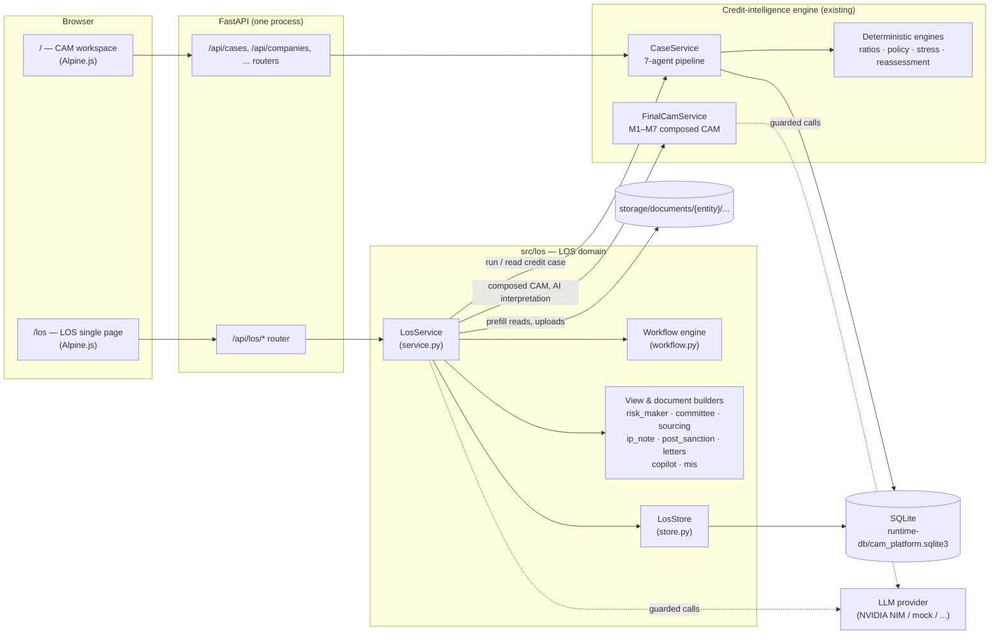

# Corporate LOS — Architecture

> How the agentic Loan Origination System (LOS) is built: components, data model,
> workflow engine, and how it sits on top of the CAM credit-intelligence engine.
> Companion documents: [Functional flow](LOS_FUNCTIONAL_FLOW.md) ·
> [AI & governance](LOS_AI_AND_GOVERNANCE.md) · [API reference](LOS_API_REFERENCE.md).

---

## 1. What the LOS is

The LOS is a demonstration corporate-lending origination system. It takes a credit
proposal from **prospect sourcing to disbursement** through five stages and 23 workflow
steps, with maker–checker controls, SLA tracking, an append-only audit trail and an
agentic copilot.

It does **not** re-implement credit analysis. The analysis — data ingestion, ratios,
policy rules, stress tests, reassessment and the composed CAM (modules M1–M7) — is the
existing **CAM Intelligence Platform** in the same codebase. The LOS is the workflow and
decision layer around it:



The same process serves the CAM workspace at `/` and the LOS at `/los`. The two share the
borrower catalog, the document store, the credit cases and the LLM provider.

## 2. Design principles

| Principle | How it shows up |
|---|---|
| **The workflow decides, people act** | Every move goes through `transition()`; the acting user must hold the step's role and be the assignee. |
| **Nothing changes without an audit event** | `LosStore.save(app, event)` writes the application and its event in one SQLite transaction. Events are append-only. |
| **Presentation, not recomputation** | LOS views (Risk Maker tabs, committee pack, letters, MIS) read the credit case and the application; they never re-derive credit figures. |
| **Data integrity** | Every displayed value carries a provenance class (source, external, calculated, derived, synthetic_demo, template, unavailable, ai). Missing data is shown as *Not available from submitted information*, never invented. |
| **AI proposes, people decide** | The LLM writes only interpretations, summaries and answers, each checked so it cannot quote figures absent from the record. The copilot runs preparatory tasks only; it never submits, approves, returns, rejects or sanctions. |
| **Configuration over code** | Groups, roles, users, stages, steps and SLAs live in `config/los_workflow.yaml`; policy thresholds in `config/rules.yaml`. |

## 3. Code layout

```
src/los/
├── workflow.py       Workflow model (groups, roles, users, stages, steps), transition rules, SLA
├── store.py          LosStore: SQLite persistence for applications and the audit trail
├── service.py        LosService: the façade the API calls — sessions, applications, actions,
│                     and every phase's operations (assessment, prefill, IP Note, conditions,
│                     disbursement, letters, copilot, MIS)
├── risk_maker.py     Risk Maker workspace: 9 tabs built from the credit case (pure function)
├── committee.py      Review & committee pack; committee_deviations()
├── sourcing.py       Document prefill: page-aware extraction, corroboration, confidence, AI fallback
├── ip_note.py        In-Principle Note: facts with provenance, ratio pre-screen, AI summary
├── post_sanction.py  Conditions tracker, deviation register, disbursement checklist, IP → AP comparison
├── letters.py        Term sheet and sanction letter (versioned, rendered to HTML)
├── copilot.py        Planner (next best actions), drafts, grounded Q&A
└── mis.py            Management MIS from applications + audit trail

src/api/routers/los.py         HTTP → LosService (no business logic)
src/application/container.py   Wires LosService with CaseService, FinalCamService, the document
                               store and the LLM factory; seeds the demo pipeline on first start
config/los_workflow.yaml       Groups, roles, demo users, stages, steps, SLAs
src/ui/templates/los.html      LOS shell (sign-in, sidebar, top bar) + includes:
src/ui/templates/los/          dashboard.html · application.html · new.html · admin.html · mis.html
src/ui/static/js/los/los.js    One Alpine component, losApp() — presentation only
src/ui/static/css/los.css      LOS styles
tests/test_los_*.py            Workflow, Risk Maker, field review, committee, sourcing,
                               post-sanction, copilot, letters & MIS
```

**Layering rule.** `routers/los.py` translates HTTP into `LosService` calls. `LosService`
owns state changes, permissions and audit. The builder modules (`risk_maker`, `committee`,
`sourcing`, `ip_note`, `post_sanction`, `letters`, `copilot`, `mis`) are pure functions of
their inputs and do no I/O, apart from the PDF reader in `sourcing.read_documents` and the
optional LLM calls, which are passed in.

## 4. Data model

### 4.1 Tables

| Table | Content |
|---|---|
| `los_applications` | One row per application: id, entity, status, stage, step, assignee and the full application JSON |
| `los_events` | Append-only audit trail: `event_id`, application, time, actor and role, action, from/to step, status, comment, `detail_json` |
| `los_sequence` | Per-year counter for application ids `LOS-YYYY-NNNNN` |

The credit cases themselves stay in the CAM platform's tables (`case_runs`, etc.).

### 4.2 The application document

An application is one JSON document. Workflow fields are set by `create` / `act`; each
phase adds its own block.

| Key | Written by | Meaning |
|---|---|---|
| `application_id`, `entity_id`, `borrower_name`, `sector`, `constitution` | create | Identity; `entity_id` links to the borrower catalog and credit cases |
| `facility`, `amount_cr` | create, prefill apply | Proposal: facility type, amount, tenor, purpose, case type |
| `stage_id`, `step_id`, `status`, `assignee_id`, `step_entered_at`, `priority`, `escalated` | act / reassign / escalate | Workflow position. Status: DRAFT, IN_PROGRESS, UNDER_REVIEW, RETURNED, APPROVED (exit), REJECTED |
| `sourcing.prefill`, `sourcing.accepted` | run_prefill / apply_prefill | Proposed values with source page and confidence; values the RM accepted or edited |
| `ip_note` | generate_ip_note | The In-Principle Note snapshot (facts, pre-screen, optional AI summary) |
| `credit_assessment` | Risk Maker job | Summary of the latest credit run: decision, requested / recommended, risk grade, run id |
| `assessments.IP`, `assessments.AP` | submit at a Risk Maker step | Snapshot of `credit_assessment` per stage (used for IP → AP comparison) |
| `field_reviews` | review_fields | Analyst confirm / override per Risk Maker field, with original value and reason |
| `sanctions.IP`, `sanctions.AP` | sanction | Committee sanction: amount, recommended, requested, minutes, facility snapshot, who / when |
| `conditions` | final sanction, update_conditions | CP / CS tracker with status, evidence, due date, history and checker approval |
| `pos_approved` | approve at Post Sanction Checker | Who approved the post-sanction documentation |
| `disbursement.checklist`, `disbursement.tranches` | dis_maker, checker, approver | Manual confirmations; tranche requested → verified → approved for release |
| `letters.term_sheet[]`, `letters.sanction_letter[]` | generate_letter | Immutable issued versions |
| `copilot_log` | copilot_ask | The last 30 questions and answers |

`LosService._view()` adds computed fields for the UI (step details, SLA state, rail,
available actions, assignee name) and replaces the bulky `sourcing` and `ip_note` blocks
with short summaries; those blocks have their own endpoints.

### 4.3 The audit trail

Every state change writes one event in the same transaction as the application. Event
actions include the workflow decisions (`create`, `submit`, `approve`, `return`, `reject`,
`allocate`, `sanction`, `reassign`, `escalate`) and the work done inside a step
(`assessment_started`, `assessment`, `field_review`, `committee_brief`, `document_upload`,
`document_prefill`, `prefill_apply`, `ip_note`, `conditions_update`, `checklist_update`,
`tranche_request`, `letter_issued`, `copilot_action`, `copilot_ask`). The MIS is computed
from this trail.

## 5. Workflow engine

`workflow.py` loads `config/los_workflow.yaml` into a `Workflow` of ordered `Step`s.

| Step kind | Actions | Effect |
|---|---|---|
| maker | submit | Next step |
| checker | approve · return · reject | Next step · back to the stage's maker step · terminal REJECTED |
| allocation | allocate | Next step, assigned to the chosen user (who must hold the target role) |
| committee | sanction · return · reject | Next step (records a sanction) · back · terminal |

Rules:

- `can_act`: the user must hold the step's role **and** be acting in it (users switch the
  active role in the sidebar).
- If the application has an assignee, only the assignee may act; others must reassign
  first (holders of the step's role, the LPF VP, CRP VP and CRP EVP, and the admin may reassign).
- A return goes to the stage's maker step and is assigned back to the person who last
  worked it (`_last_worker`). Return and reject require a comment.
- Leaving the last step (Disbursement Approver) completes the application (APPROVED,
  shown as *Exit (approved)*).
- SLA: `due = entered + sla_days` (calendar days); `sla_state` reports days remaining and
  whether the step is breached.

**Gates** (enforced in `LosService.act`, besides the workflow rules):

| Step | Cannot be submitted until |
|---|---|
| IP Note Processing | the IP Note has been generated |
| Risk Maker (IP and AP) | a credit assessment has been recorded |
| Post Sanction Maker | every condition precedent is satisfied, deferred or waived |
| Disbursement Maker | a tranche is recorded and the checklist is complete |
| Committee (sanction) | a sanction that differs from the recommendation, or follows a "not supported" decision, has minutes; the amount cannot exceed the request |

Hooks after a decision (`LosService._after_action`): snapshot the assessment at Risk Maker
submit, build the conditions at the final sanction, stamp checker approval on waivers and
deferrals, and move the tranche through verified → approved for release (or back on a VP rework).

## 6. Integration with the credit-intelligence engine

| LOS need | CAM component used |
|---|---|
| Run the credit assessment at a Risk Maker step | `CaseService.run(entity_id, on_progress)` in a background thread; progress is mapped to the 7 agents and 21 CAM sections |
| Read the latest case | `CaseService.get` + `FinalCamService.get` (re-syncs M1–M7: challenges, repayment, stress, reassessment, composed CAM) |
| Risk Maker tabs | `risk_maker.build_risk_maker_view(case, final_cam, context)` |
| Committee pack, deviations, conditions | `case["reassessment"]` (M6), `tier1_decisions`, `stress_test`, the composed CAM |
| AI committee brief | `FinalCamService.interpret(entity, ["executive_summary", "final_recommendation"])` |
| Borrower master, financials, collateral, exposure | the borrower catalog (`AppState.companies`) |
| Ratio pre-screen (IP Note) | `src/engines/ratio_engine.py` + `rules.yaml → policy_thresholds` |
| Documents | `storage/documents/{entity}/{category}/` via `DocumentStore` (uploads never overwrite) |
| HTML rendering | `src/rendering/cam_markdown.markdown_to_html` |

Background jobs: the assessment runs in a thread per application. The job state (`running`,
`done`, `failed`, progress and message) is held in memory; the result and its audit event
are saved to SQLite. Anything that saves the application while a job may be running
records its own event first (see `copilot_run`), so it never overwrites the job's result.

## 7. Sessions and permissions

The demo sign-in is a picker: group → user → role, with no passwords. `POST /api/los/session`
returns a token kept in the browser's `sessionStorage` and sent as `X-LOS-Session`. Sessions
are in memory, so a server restart signs everyone out. Every write checks the session's
active role against the step (and the assignee), and a few operations against fixed roles
(the RM issues the term sheet; the Post Sanction Maker issues the sanction letter; only
`los_admin` may reset the demo).

## 8. Front end

`/los` is rendered by `render_spa("los.html")`, which expands
`<!-- include: los/*.html -->` directives. A single Alpine component, `losApp()` in
`los.js`, holds the UI state and calls `/api/los/*`. Hash routes: `#dashboard`, `#queue`,
`#mis`, `#new`, `#app/{id}`, `#audit`, `#admin`.

The application page loads its panels in parallel: Risk Maker workspace, committee pack,
sourcing, IP Note, post-sanction, copilot and letters. Each panel shows itself only when
relevant to the step or once its data exists.

## 9. Demo data

`seed_demo()` creates seven applications on first start (or on **Administration → Reset
demo**), replaying each through the real workflow with timestamps spread over the past
weeks:

| Borrower | Seeded at | Shows |
|---|---|---|
| ABCE001 | IP Risk Maker | Run the assessment, review fields |
| IHCL001 | Prospect Sourcing (draft) | Document prefill, copilot, IP Note |
| APOL001 | IP Sanction Committee, SLA breached | Committee pack, AI brief, sanction |
| MFL001 | IP Risk Maker, returned | Return with comment, rework |
| MRF001 | AP Risk Maker, SLA breached | Reassessment, IP → AP comparison, term sheet |
| INFY001 | Post Sanction Maker | Conditions tracker, sanction letter |
| PNCR001 | Disbursement Maker, escalated | Checklist, tranche, completion |

Replayed history records what a real run would (IP Note, assessment summary, satisfied
CPs) and is flagged `seeded`. The MIS states that it includes seeded history.

## 10. Known limits (demo scope)

- Authentication is a demo picker; sessions are in memory.
- SQLite and in-process background threads; a single server process.
- Bank systems are not connected. PAN/NSDL, CERSAI, CBS, bureau, AML and the bank's
  rating, PD/LGD and pricing models are shown as *Not available* or as labelled
  synthetic demo values.
- SLAs use calendar days.
- The copilot planner is rule-based; the LLM is used for answers, summaries and the
  prefill fallback (see [AI & governance](LOS_AI_AND_GOVERNANCE.md)).
