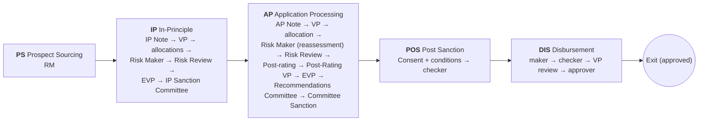

# Corporate LOS — Functional Flow

> What happens at each stage: who acts, what they see, what the system checks and what it
> records. For the technical design see [Architecture](LOS_ARCHITECTURE.md).

---

## 1. The journey at a glance

Five stages, 25 steps, five user groups. Each step belongs to one role. A maker submits;
a checker approves, returns (back to the stage's maker, with a comment) or rejects; an
allocation step assigns the next person; a committee sanctions, returns or rejects; the
disbursement **VP review** is a read-only gate with *Submit* or *Rework*.

Before the first submission — and again at each Risk Maker — a **governed due-diligence
workspace** (fifteen checks) must be complete: a pending, failed or unexcepted *mandatory*
check blocks the submission. See [§4.0](#40-the-governed-due-diligence-workspace-every-new-application).

## 2. Users and roles (demo)

Sign-in is a picker with no passwords: choose a group, a user and a role. Users with two
roles (for example Rahul Bansal: CRP VP and Risk Reviewer) switch role in the sidebar.

| Group | Role | Demo user |
|---|---|---|
| Sourcing & Relationship | Prospect Sourcing Maker (RM) | Ananya Rao, Karan Malhotra |
| | LPF VP | Vivek Iyer |
| Credit & Risk | CRP EVP | Meera Krishnan |
| | CRP VP / Risk Reviewer | Rahul Bansal |
| | Risk Analyst (Risk Maker) | Neha Kulkarni, Arjun Menon |
| | Post Risk Rating Maker | Arjun Menon |
| | Compliance VP | Priya Raghavan |
| Executive & Committee | EVP Recommender | Sunil Chopra |
| | Recommendations Committee | Recommendations Committee Secretariat |
| | Sanction Committee | Credit Committee Secretariat |
| Operations & Fulfilment | Post Sanction Maker / Checker | Farah Sheikh / Gautam Das |
| | Disbursement Maker / Checker / VP / Approver | Lakshmi Narayan / Rohit Saxena / Vikram Desai / Pooja Venkat |
| System Administration | LOS System Admin | LOS Administrator |

## 3. Screens

| Screen | Purpose |
|---|---|
| **Pipeline Dashboard** | KPIs, stage distribution, all applications with filters, and the *Copilot — your priorities* digest |
| **My Queue** | Applications waiting for the active role (assigned to you or unassigned) |
| **Management MIS** | Pipeline, ageing, turnaround and SLA compliance, breaches by role, decision quality, sanctions, conditions, copilot usage |
| **New Application** | RM creates a draft for a borrower in the catalog (amount, facility, tenor, purpose) |
| **Application Detail** | Stage rail, the current step card with actions, and the panels for the step (below) |
| **Audit Trail** | Every event across applications |
| **Administration** | Reset the demo pipeline (admin) |

The application detail page shows these panels when they apply:

| Panel | Shown | Content |
|---|---|---|
| Step card | Always | Step, role, assignee, SLA, available actions, comment box, gate warnings, reassign and escalate |
| **Copilot** | Always | Next best actions with *Do it* / *Draft*, Q&A on the application |
| **Documents & AI prefill** | Prospect Sourcing (and afterwards, read-only) | Documents on file, upload, proposed values with confidence and source page |
| **Due diligence (governed workspace)** | Prospect Sourcing, IP Note and Risk Maker steps | The fifteen checks: run / re-run API checks, record manual checks, comments, Compliance VP exceptions |
| **IP Note** | IP Note step, or once generated | Borrower and proposal facts, financial snapshot, security cover, policy pre-screen, AI summary |
| **Committee pack** | Review and committee steps, and after sanction | Decision headline, overrides, risks, open items, deviations, conditions, comments, AI brief |
| **Risk Maker workspace** | Risk Maker steps, or once assessed | The credit assessment in 9 tabs with field review |
| **Term sheet & sanction letter** | After the IP / final sanction | Issue, re-issue and open versions |
| **Post sanction & disbursement** | After a sanction | Conditions, deviation register, IP → AP comparison, disbursement |
| Application / Activity tabs | Always | Application details; the audit trail for this application |

## 4. Stage by stage

### 4.1 Prospect Sourcing (PS)

| Step | Who | What happens |
|---|---|---|
| Prospect Sourcing | RM | Creates the draft, uploads documents, completes the **due-diligence workspace**, runs the **document prefill**, accepts or edits the proposed values, submits (gate: mandatory DD checks complete) |

**Customer identity & deduplication.** On the New Application page (and stored with the
application): the NTB/ETB classification, customer ID / CIF selection, PAN, name as per
PAN, CIN (with format validation), GSTIN, date of incorporation, constitution, the
**CBS customer search** result (found / not found, demo data) and the **LOS duplicate
check** — other applications for the same entity, PAN or CIN, each flagged with what it
matched on. The RM also records the **sourcing decision** (*Refer for in-principle*,
*Request further information*, *Defer*, *Decline*) with remarks for the mandatory and
conditional fields, and the **prospect discussion** (project type, funding type, brief
and detailed description, initial sourcing remarks).

### 4.0 The governed due-diligence workspace (every new application)

Fifteen checks — eight run against the in-app record and demo services, seven recorded
manually — each with a status (*pending / clear / matched / failed / unavailable*), a
trigger history (re-runs never erase earlier results), comments, last trigger and
triggering user, and — for a blocked check — a **Compliance VP exception** with a reason.

| API checks (run / re-run from the workspace) | Manual checks (recorded) |
|---|---|
| MCA — company & corporate information | CRILC — large credit check |
| CIBIL — commercial credit report | Central Fraud Registry |
| CRIF — bureau score & status | CEIB — entity & relationship search |
| Legal litigation check | Enhanced Due Diligence |
| Early Warning Signals (account conduct) | UDIN — professional document verification |
| GSTIN verification | KYC — identity & address evidence |
| LEI verification | MLRA — money-laundering risk assessment |
| Name screening (PEP / sanctions) | |

Five checks are mandatory by demo default (MCA, CRILC, KYC, name screening, MLRA).
A mandatory check that is *pending*, *failed*, or *matched* without an approved
exception **blocks the submission** at Prospect Sourcing, IP Note and both Risk Maker
steps. *Unavailable* means the provider returned nothing — an operational state that
never blocks and is never presented as a clear result. The only way to release a
mandatory match or failure is a recorded **Compliance VP exception**; every trigger,
recording and exception is an audited event. All data is demo data, labelled as such.

**Document prefill.** The system reads every PDF on file page by page (the first 12 pages
of long filings) and proposes 21 fields: legal name, CIN, PAN, GSTIN, incorporation date,
registered office, listing, authorised signatory, facility type, case type, amount, tenor,
purpose, latest revenue, EBITDA, PAT, net worth and debt, external rating, and collateral
market and forced-sale values. Each proposal shows:

- the **source**: document, page, and the text it was read from (hover);
- a **confidence** (high / to confirm / low): higher when several documents agree or the
  value matches the borrower master; *conflict* when documents disagree, listing each
  alternative; *not found* when no document has it;
- interim filings (quarterly or unaudited) are never used for annual figures.

Nothing is applied until the RM accepts it. *Accept all high-confidence* takes the
high-confidence values; any value can be edited, with a reason. Accepted facility values
(amount, tenor, purpose, type) update the application. Uploads accept PDFs only and never
overwrite a document already on file.

### 4.2 In-Principle (IP)

| Step | Who | What happens |
|---|---|---|
| IP Note Processing | RM | Generates the **IP Note** (gate: required before submit), submits |
| IP Note VP Review | LPF VP | Approves or returns |
| CRP EVP Allocation | CRP EVP | Allocates to a CRP VP |
| CRP VP Allocation | CRP VP | Allocates to a Risk Analyst |
| Risk Maker (Credit Assessment) | Risk Analyst | Runs the **credit assessment**, reviews fields, submits (gate: assessment required) |
| CRP VP Risk Review | Risk Reviewer | Reviews the work and the **committee pack**; approves or returns |
| IP Note EVP Recommendation | EVP | Recommends (approves) or returns |
| IP Sanction Committee | Committee | **Sanctions** (amount and minutes), returns or rejects |

**IP Note.** Built from the accepted prefill values (each citing document and page) or the
borrower master, the proposal, existing exposure, the last three audited years, security
cover (forced-sale value ÷ proposed amount), and a **policy pre-screen**: EBITDA margin,
debt/equity, debt/EBITDA, interest coverage, DSCR, current ratio and ROE against
`rules.yaml → policy_thresholds`, each marked pass, breach or not available. The outcome is
*within thresholds*, *proceed with N exceptions noted* or *refer*. An optional AI summary is
added only if every figure it quotes is in the note. A printable view is available.

**Credit assessment (Risk Maker).** *Run credit assessment* starts the CAM
credit-intelligence pipeline (7 agents, 21 CAM sections) in the background with live
progress. The result opens in nine tabs: Customer Info, Financial Statements, Risk Rating,
Project Info, Security & Collateral, Terms & Covenants, Pricing & RAROC, ESMS / ESDD and
Decision Signoff. Each field shows its basis (source, calculated, rule-based, demo, N/A).
Bank models that are not connected (internal rating scale, PD/LGD, pricing, RAROC) are
shown as labelled demo values.

**Field review.** The Risk Maker can **confirm** a field or **override** it with a value
and a reason. The engine value is never changed; the override sits beside it. If a later
run changes the engine value, the review becomes *stale* and must be re-checked.
Unreviewed fields go to the reviewer marked as unreviewed.

**Committee pack** (Risk Review, EVP and committee steps): the decision headline (requested
vs recommended, decision, grade), the Risk Maker's overrides, unresolved risks, open due
diligence, deviations (failed or unverified hard rules, policy-limit breaches, a
recommendation that differs from the system's), conditions, every comment so far, and
links to the full CAM. The committee can generate an **AI brief** (the number-checked CAM
interpretation of the executive summary and recommendation).

**Sanction.** The amount defaults to the reassessed recommendation. A different amount, or
a sanction after a *not supported* decision, needs minutes; the amount cannot exceed the
request. The sanction is recorded with a snapshot of the facility.

### 4.3 Application Processing (AP)

| Step | Who | What happens |
|---|---|---|
| Application Note Processing | RM | Submits (an RM can issue the **term sheet** once the IP sanction exists) |
| LPF VP AP Review | LPF VP | Approves or returns |
| CRP VP Allocation | CRP VP | Allocates to a Risk Analyst |
| Risk Maker (Credit Reassessment) | Risk Analyst | Re-runs the assessment, reviews, submits (gate: mandatory DD checks complete) |
| Risk Review | Risk Reviewer | Approves or returns |
| Post Risk Rating Processing | Post Risk Rating Maker | Submits |
| Post-Rating VP Review | CRP VP | Approves or returns |
| EVP Recommendation | EVP | Approves or returns |
| Recommendations Committee | Recommendations Committee | Records the recommendation (*sanction / return / reject*); it does not create the conditions |
| Committee Sanction | Sanction Committee | Final **sanction**; this creates the **conditions tracker** |

The **IP → AP comparison** shows proposal, assessment and sanction side by side and
highlights what changed. When both stages used the same credit run, it says so.

### 4.4 Post Sanction (POS)

| Step | Who | What happens |
|---|---|---|
| Post Sanction Maker | POS Maker | Records the customer's **sanction consent** and per-facility execution, clears conditions precedent, issues the **sanction letter**, submits (gates: consent recorded and no CP open) |
| Post Sanction Checker | POS Checker | Approves (which approves every waiver and deferral) or returns — a **comment is mandatory for every decision** at this step |

**Sanction consent & facility execution.** Before the documentation can be submitted, the
POS Maker records the customer's acknowledgement of the sanction (who acknowledged, date,
remarks) and the execution status of **every facility** (*executed* / *partial* /
*not_executed*, with the facility-agreement date for executed facilities). A not-executed
or partial facility does not block, but is recorded and visible.

**Conditions tracker.** Conditions come from the credit reassessment where a case exists,
plus the bank's standard documentation conditions (labelled *template*). Each condition
can be:

- **satisfied**: needs evidence (a document on file) or a note;
- **deferred**: needs a new due date after today and a reason;
- **waived**: needs a reason;
- **reopened**.

Conditions subsequent are due 90 days after sanction and show *overdue* once past. Waivers
and deferrals wait for the checker and appear in the deviation register until approved.

**Deviation register.** One list of everything that departs from policy or the proposal:
policy exceptions accepted at sanction, a sanction that differs from the recommendation (with
its minutes) or is below the request, an IP → AP change in amount, and condition waivers
and deferrals. Each entry shows the approving authority and its status.

**Sanction letter.** Built from the final sanction, borrower master, conditions tracker,
covenants (from the credit case, else the credit-policy thresholds), security and the
deviations approved. Pricing is the demo grid, labelled as not a bank rate. Each issue is a
new version with a reference (`LOS-YYYY-NNNNN/SL/n`); earlier versions stay available. The
document is marked as a demo document.

### 4.5 Disbursement (DIS)

| Step | Who | What happens |
|---|---|---|
| Disbursement Maker | DIS Maker | Records the tranche, completes the checklist, submits (gate: both done) |
| Disbursement Checker | DIS Checker | Verifies the tranche (approve) or returns it |
| Disbursement VP Review | DIS VP | Read-only repeat review (*Submit* or *Rework* back to the Maker, with a comment); significant changes observed are recorded with the review; the tranche stays verified |
| Disbursement Approver | DIS Approver | Approves; the tranche is **approved for release** and the application reaches **Exit (approved)** |

**Checklist.** Three system checks (CPs cleared, post-sanction documentation approved,
tranche within the undisbursed limit) and five manual confirmations (security documents
executed, charge registered with ROC / CERSAI, limit set up in core banking, disbursement
request received, insurance assigned). Registry and core-banking items say they are not
connected and are confirmed manually.

**Tranche.** Amount (up to the undisbursed sanctioned limit), value date and purpose.
*requested* → *verified* (checker) → *approved* (approver). A rework sends it back to
*requested*. The LOS ends at workflow approval — the *authorisation to release*;
actual payment execution and reconciliation with core banking happen outside the LOS.

## 5. Across every step

- **SLA.** Each step has an SLA in days. The step card, dashboard and digest flag breaches.
- **Escalate.** Anyone can escalate an active application with a comment; it is flagged
  until the next decision.
- **Reassign.** Holders of the step's role, the LPF / CRP VPs and EVP, and the admin can
  move work to another eligible user.
- **Returns** go back to the person who last worked the maker step, with the comment shown
  on their step card and in the copilot.
- **Copilot.** Proposes the next action for the step (see
  [AI & governance](LOS_AI_AND_GOVERNANCE.md)), can run preparatory tasks, drafts return
  notes and document requests, and answers questions from the application's record.
- **Audit.** Every action, including copilot runs and questions, appears under *Activity &
  audit* and in the global *Audit Trail*.

## 6. Demo walkthrough

The pipeline is seeded with seven applications (reset any time from **Administration**).

| # | Sign in as | Open | Show |
|---|---|---|---|
| 1 | Ananya Rao · RM | IHCL001 (Prospect Sourcing) | The copilot's first job: *Run all API checks* in the due-diligence workspace, record the manual ones — IHCL's name screening *matches* a PEP record, so the **Compliance VP** (Priya Raghavan) approves the exception — then prefill, accept high-confidence, *Draft request* for the missing items, submit |
| 2 | Ananya Rao · RM | IHCL001 (IP Note) | Copilot → *Generate IP Note*; pre-screen exception; printable view; submit |
| 3 | Vivek Iyer · LPF VP | IHCL001 (IP Note VP Review) | Approve |
| 4 | Neha Kulkarni · Risk Analyst | ABCE001 (Risk Maker) | Run the credit assessment, browse the 9 tabs, override the internal rating with a reason |
| 5 | Credit Committee Secretariat · Committee | APOL001 (IP Sanction Committee, SLA breached) | Digest on the dashboard; committee pack; ask the copilot "what are the main unresolved risks?"; sanction |
| 6 | Arjun Menon · Risk Analyst | MRF001 (AP Risk Maker) | IP → AP comparison; term sheet (as RM) |
| 7 | Farah Sheikh · POS Maker | INFY001 (Post Sanction) | Record the sanction consent and facility execution; waive a CP with a reason → deviation register; copilot issues the sanction letter; clear CPs; submit (the checker needs a comment) |
| 8 | Lakshmi Narayan · DIS Maker | PNCR001 (Disbursement, escalated) | Record a tranche, tick the checklist, submit; then checker, Disbursement VP review (Submit / Rework) and approver → *Exit (approved)* |
| 9 | Sunil Chopra · EVP | Management MIS | Pipeline, turnaround, SLA by role, return rates, copilot adoption |
