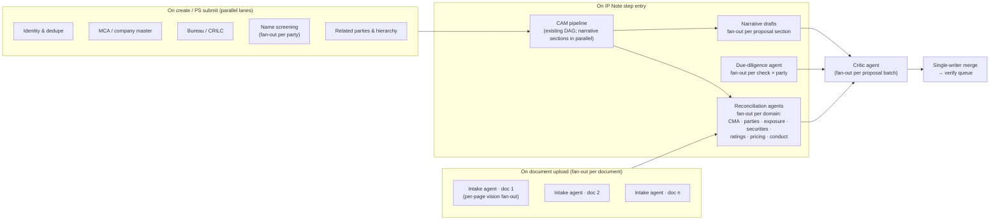

# POC Build Plan — Agentic LOS (one bank, end to end)

> **What this is:** the build plan for a **proof of concept** run with one bank, end to end
> (Prospect Sourcing → Exit). It needs the bare-minimum functionality and architecture.
> **It is not production grade.**
> Where this plan conflicts with [AUTO_POPULATION_TECH_GAPS.md](planning/AUTO_POPULATION_TECH_GAPS.md) or
> [PROCESS_GAP_BACKLOG.md](planning/PROCESS_GAP_BACKLOG.md), **this plan wins**; those stay as the longer-term target.
>
> **Status (Oct 2026):** all six sprints are built (§4). The journey runs end to end on the fictional
> demo set, and the bank's own documents are next. What remains is in [ROADMAP.md](ROADMAP.md); the
> design as built is in [TECHNICAL_ARCHITECTURE.html](TECHNICAL_ARCHITECTURE.html).

---

## 1. POC principles

1. **One case, end to end, on the bank's own documents.** The bank brings a real borrower's
   document set. The LOS sources it, auto-populates it, the CAM is generated, people verify,
   and the case moves through sanction, post-sanction and disbursement to Exit.
2. **Auto-populate first; people verify by exception.** This is the demo's headline metric:
   *% of fields arriving pre-filled and accepted unchanged*.
3. **Multi-agent, parallel by default.** Any work that does not depend on other work runs at
   the same time. Dependencies are declared, never implied by code order.
4. **Bare minimum.** Keep SQLite, in-process threads, the demo sign-in picker and labelled demo
   data for bank systems. No new infrastructure.
5. **Deterministic figures, AI reasoning.** Agents decide and draft; plain-code tools calculate;
   the critic checks. Agents propose; people decide.

---

## 2. Parallel multi-agent architecture

### 2.1 One scheduler for every agent graph
[pipeline.py](../src/agents/pipeline.py) already has a dependency-graph scheduler. Agents
declare `requires` and `waits_for` and run on a `ThreadPoolExecutor` as soon as their inputs are
ready. The POC **generalises it into `AgentGraph`** (`src/agentic/graph.py`) and uses it everywhere:

- **Nodes** are agents or tools. Each declares `requires`, `waits_for` and an output key.
- **Fan-out nodes** expand at run time into N parallel children, then join:
  - one per document
  - one per page
  - one per related party
  - one per check
  - one per field domain
  - one per CAM section
- **Concurrency limits.** The global thread pool is bounded by a `max_workers` setting. A
  **per-provider LLM semaphore** (the existing `max_parallel_sections` setting, generalised to
  `max_parallel_llm`) prevents rate-limit storms. Deterministic tools are not throttled.
- **A deterministic join.** Results are collected by node id, not completion order, so a run's
  output does not depend on timing (the pipeline already guarantees this).
- **Failure isolation.** A failed branch marks its outputs `unavailable` and the graph continues,
  unless a node `requires` it.
- **Progress events.** Every node emits server-sent events (SSE); the UI shows the parallel lanes live.

### 2.2 Single writer
Agents never write to the application directly. Each branch returns **proposals**. One
**merge step** at the join takes a per-application lock and applies the merge rules:
- never overwrite a confirmed value
- a difference from a confirmed value becomes a conflict

It then writes once, with one audit event. This is how parallel agents stay safe on SQLite.

### 2.3 Agent graphs per trigger

| Trigger | What runs in parallel | Joins on |
|---|---|---|
| Document upload | One intake agent per document; per-page extraction inside each | Classification + field proposals per document |
| Application created | Identity/dedupe ‖ MCA ‖ bureau/CRILC ‖ name screening (per party) ‖ hierarchy/parties | PS screen populated |
| IP Note step entry | CAM pipeline (existing DAG) ‖ due-diligence (per check × party), then reconciliation per domain ‖ narrative per section | IP workspaces populated + IP Note |
| AP step entry | Refresh: changed documents only ‖ re-run engines whose inputs changed ‖ ESMS/security/project reconciliation | AP workspaces refreshed |
| Override confirmed | Recompute only the dependent engines (ratio → RAROC → CAM sections), in dependency order and in parallel where independent | Stale fields re-proposed |
| POS / DIS step entry | Intake for the signed sanction letter, facility agreement and drawdown request ‖ pre-fill disbursement terms from the sanction | POS/DIS screens populated |

### 2.4 Agents (POC set)
| Agent | POC scope |
|---|---|
| **Orchestrator** | Picks the graph for a trigger and returns a "ready for review" brief |
| **Document intake** | Classify + extract with page evidence; LLM vision for scanned or unstructured pages; one extraction path (replaces the separate PS regex prefill) |
| **Reconciliation** | One instance per domain: compares document, external and engine values, then proposes or raises a conflict |
| **Due diligence** | Runs the applicable demo checks; summarises adverse findings |
| **Narrative** | Existing CAM narrative + proposal/ESMS drafts from confirmed facts |
| **Critic** | Number-guard + evidence check on every proposal and draft |
| **Copilot** | Keep as is; upgrade its Q&A to call the same read tools |

Deferred until after the POC: a separate policy/deviation agent (the policy engine output is
shown as is), an MCP server, and the LLM-planner copilot.

---

## 3. POC scope

### 3.1 Technical (from AUTO_POPULATION_TECH_GAPS)
| ID | POC | How (minimum) |
|---|---|---|
| T-01 mapping layer | **In** | Field registry YAML + resolvers for the populated domains |
| T-02 FieldValue model | **In** | Stored **inside the application JSON** (POC simplification; a separate table comes later) |
| T-03 overrides feed back | **In (simple)** | Confirmed values become `company_data` overrides; re-run dependent engines |
| T-04 one extraction path | **In** | Intake agent; retire the separate PS regex prefill |
| T-05 pin the case to the application | **In** | `run_id` per stage on the application |
| T-06 early, event-driven runs | **In** | Triggers in §2.3 on in-process threads |
| T-07 merge policy | **In** | Single-writer rules (§2.2) |
| T-08 narrative drafts | **In** | Proposal background, strengths, risks, industry, ESMS summary |
| T-09 later-stage extractors | **Partial** | Signed sanction letter, facility agreement, drawdown request only |
| T-10 no catalog dependency | **In** | A new borrower is built from documents + (demo) external fetch; required because the bank's borrower is not in the catalog |
| T-11 verify queue | **In (simple)** | One queue per step: low-confidence, conflicts, AI drafts; bulk confirm |
| T-12 metrics | **Minimal** | One panel: populated %, accepted-unchanged %, overridden % |
| T-13 durable jobs | Out | In-process threads are enough for one bank |
| T-14 golden-set harness | Minimal | The bank's POC document set + expected values, as one test |

### 3.2 Functional (from PROCESS_GAP_BACKLOG)
| ID | POC | Note |
|---|---|---|
| G-01 Defer | **In (simple)** | Deferred status + reactivate; no reminders |
| G-02 outcome sets | **In** | Drop at makers; trim the disbursement approver; process labels |
| G-03 remarks on every decision | **In** | Config flag |
| G-04 review decision fields | **In (simple)** | Significant changes + material-information date at the configured steps |
| G-05 read-only reviewers | **In (simple)** | Checker/VP/committee steps cannot call edit endpoints |
| G-06 authority routing | Out | Fixed chain; the computed authority is displayed |
| G-07 new borrower | **In** | Merged with T-10 |
| G-08 PS fields | **Minimal** | Subsector, branch, currency, discussion date/participants, populated where possible |
| G-09 / G-10 gates | **In (simple)** | IP Note gate = blocking checks + mandatory documents; existing gates kept |
| G-11 – G-14 | Out | — |
| G-15 docs / seed | **Minimal** | A demo script and one seeded showcase |

### 3.3 Explicitly out of the POC
- real authentication
- production database or job queue
- real bank integrations: CBS, bureau and screening stay labelled demo
- bank rating, RAROC and pricing models
- authority-matrix routing
- performance and security hardening
- multi-tenant support
- payment execution

---

## 4. Build sequence

| Sprint | Build | Demo at the end |
|---|---|---|
| **S1. Agent framework** ✅ | `AgentGraph` (generalised scheduler with fan-out, LLM semaphore, deterministic join, SSE); tool registry (typed, audited); structured-output + vision in the LLM provider; critic agent; current models in config | The existing CAM pipeline runs on `AgentGraph` with unchanged output; a parallel-lanes progress view |
| **S2. Populate → Verify core** ✅ | Field registry; FieldValue in the application; single-writer merge; verify queue with bulk confirm; case pinned to the application | Risk Maker fields served through the new model |
| **S3. Intake + new borrower** ✅ | Document intake agent (per-document/per-page fan-out); borrower built from documents; create-time parallel lanes | Upload a document set for an unknown company → PS screen populated |
| **S4. Reconciliation fan-out** ✅ | Domain agents: CMA, parties, exposure, securities, ratings, pricing, conduct; due-diligence agent per check × party; narrative drafts | IP Note step opens with workspaces populated and the IP Note drafted |
| **S5. Feedback + workflow parity** ✅ (G-09 PS dedupe acknowledgement still open) | Overrides re-flow to engines; G-01/02/03/04/05/09/10 | Override revenue → ratios, CAM and RAROC refresh; defer/drop/rework work |
| **S6. Later stages + POC polish** ✅ (run on the fictional demo set; the bank's own documents still to come) | POS/DIS intake (signed letter, agreement, drawdown request); metrics panel; demo script; golden-set test | Full run PS → Exit on the bank's documents, with the auto-population metric |

---

## 5. Decisions taken for the POC (from §7 of the tech doc)

| Decision | POC choice |
|---|---|
| FieldValue storage | Inside the application JSON |
| Auto-accept without a human touch | No. Everything needs at least a bulk confirm; high-confidence values are pre-ticked |
| Re-run budget | Deterministic engines re-run automatically; LLM narrative re-runs at step entry or on request |
| May agents trigger external checks? | Yes. In the POC the checks are demo or labelled sources, so there is no cost concern |
| LLM provider | One hosted provider for the demo (current model) + `mock` for tests |
