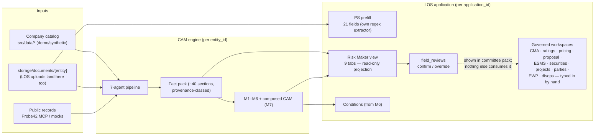
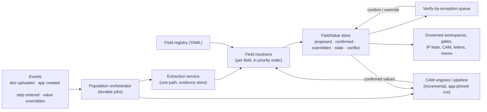
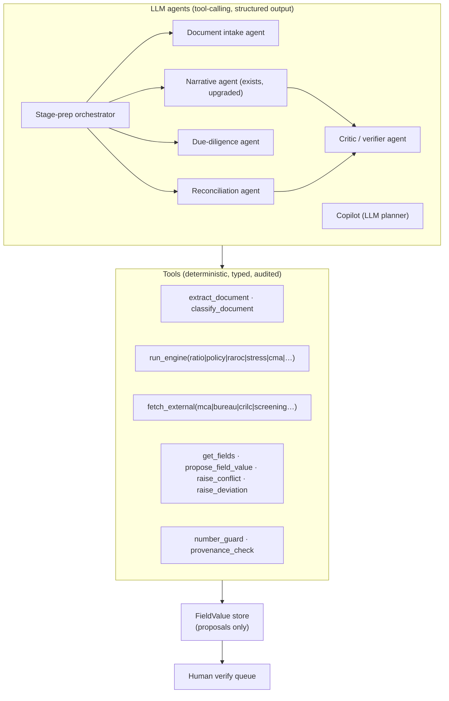

# Auto-Population — Technical Gap Analysis and Target Design

> **Principle:** the CAM engine is the core. LOS users should not key in data: the system
> **populates** every field it can from documents, external sources and the CAM engines, and
> people **verify by exception**. The time saved comes from the share of fields that arrive
> pre-filled, with provenance, and need only a confirm.
>
> Companion documents: [PROCESS_GAP_BACKLOG.md](PROCESS_GAP_BACKLOG.md) (functional gaps)
> and [MODERNISATION_GAP_ANALYSIS.md](MODERNISATION_GAP_ANALYSIS.md) (bank alignment).
> Based on commit `82117cf`. Items marked *(verify)* were read from the code, not run.

---

## 1. How data flows today

The CAM side and the LOS side are **two parallel worlds**. They are connected by only four
bridges:

| Bridge | What it does | Limitation |
|---|---|---|
| **PS prefill** ([sourcing.py](../../src/los/sourcing.py)) | Regex extraction of 21 sourcing fields with page, confidence and corroboration; RM accepts or edits | A **separate extractor** from the CAM's [document_extractor.py](../../src/services/document_extractor.py); covers PS only |
| **Risk Maker view** ([risk_maker.py](../../src/los/risk_maker.py)) | Projects the fact pack and M1–M7 into 9 tabs; each field can be confirmed or overridden | Read-only projection. Overrides are stored in `app.field_reviews` and shown in the committee pack, but **do not update the governed records, re-run engines or flow into letters** |
| **Conditions** ([post_sanction.py](../../src/los/post_sanction.py)) | CP/CS/covenants are built from M6 plus standard templates | Works, and is the one complete bridge |
| **A few seeds** | External rating from the catalog ([ratings.py:47](../../src/los/ratings.py#L47)); facility from the catalog; IP Note facts | Thin |

Every other governed workspace **starts empty** and is filled through about 29 manual save
endpoints:
- CMA: `initial_cma` says "starts empty; the maker records entity-wise rows"
  ([cma.py:44](../../src/los/cma.py#L44))
- pricing ([pricing.py:23](../../src/los/pricing.py#L23))
- ESMS ([esms.py:37](../../src/los/esms.py#L37))
- proposal narrative, exposure, banking and conduct ([proposal.py:24](../../src/los/proposal.py#L24))
- securities, projects, EWPs (`[]` at create)
- related parties (typed in at create)

This happens even though the fact pack already holds much of that data.

---

## 2. Field coverage: what the engine has vs what the LOS asks people to type

| LOS domain | Already available in the CAM engine | LOS today | Gap |
|---|---|---|---|
| Borrower identity, constitution, address | Borrower master + MCA (Probe42) | Borrower master read-only from the catalog | Make it populated and verifiable in the LOS; editable on override |
| Related parties (directors, shareholders, group, beneficial owners) | `corporate_hierarchy`, directors, MCA, Probe bundle | **Typed in at create** | **Auto-populate** |
| Facilities (type, amount, tenor, purpose) | Catalog facility + prefill | Prefill proposes some fields | Extend to multiple facilities from the proposal letter / request |
| Exposure (existing, group, bureau) | `core_banking`, `crilc_exposure`, bureau, ETB analytics | Manual "Fetch" button (demo) | **Auto-populate** |
| Verification checks (MCA, bureau, CRILC, PEP, GST, litigation…) | `data_sources`, `compliance_checks`, `pep_screening`, `crilc_exposure` | 15 checks triggered separately; results recorded per check *(verify whether any read the fact pack)* | Seed check results and evidence from the pipeline run |
| **CMA / financials** (multi-year, audited/provisional/projected) | `financial_summary`, ratios by period, `financial_projections`, uploaded-financials overrides | **Empty; typed in by hand** | **Biggest gap: auto-populate every row** |
| Ratings | External rating (catalog); `risk_grade` / risk score (policy engine); MLRA is synthetic | External seeded; internal empty | Populate internal and engine grades as proposals |
| Pricing / RAROC | `facility_pricing` (demo grid), RAROC calculator | Empty pricing; RAROC computed on demand | Populate recommended pricing; compute RAROC automatically |
| Proposal narrative (business, industry outlook, governance, strengths, weaknesses, risks) | 21-section narrative, `credit_strengths`, `key_risks`, `industry_analysis`, M7 sections | **Empty** | **Auto-draft (guarded AI) and verify** |
| Banking arrangement and 12-month conduct | `conduct_summary`, `etb_behavioral_analytics`, `bank_statement_analysis` | Empty | **Auto-populate** |
| Securities (type, value, charge, valuation date) | `collateral_summary`, `valuation_report_data`, `charges_data` (MCA charges) | **Empty; typed in by hand** | **Auto-populate** |
| Projects (cost, means of finance, DCCO, TEV) | Little: no TEV/DPR extractor | Typed in by hand | Needs a new extractor (TEV/DPR, LIE reports) |
| ESMS screen | `esg_regulatory`, social media and news signals | Empty checklist | Populate the screening proposal plus evidence; humans answer only what is unknown |
| Deviations | `policy_decisions`, `validation_exceptions` | Recorded manually or at sanction | Auto-raise deviations from policy breaches |
| Conditions and covenants | M6 | **Auto-populated** | Covered |
| POS: execution date, consent, signed letter | Nothing yet | Typed in by hand | Needs extractors for the facility agreement and signed sanction letter |
| DIS: beneficiary, IFSC, amount, repayment and interest terms | Sanction terms in the record; drawdown request not extracted | Typed in by hand | Pre-fill from sanction + drawdown-request extraction; CBS IDs stay manual until integrated |
| Letters, memo, IP Note | Generated from the record | Covered | Inherits whatever populated values are confirmed |

Roughly, **10 of 17 domains already have their data inside the engine and only need a
mapping layer**. Four need new extractors. Three are already covered.

---

## 3. Technical gaps

### T-01 · No mapping layer between the engine and the LOS fields *(core gap)*
There is no component that takes `fact_pack + M1–M7 + extraction` and writes **proposed
values** into the LOS governed records. Each workspace module has its own `normalise_*`
functions for *human input* only.

### T-02 · No unified field model
Three different shapes exist today:
- Risk Maker fields carry `provenance` classes
  ([data_provenance.py](../../src/engines/data_provenance.py)).
- Prefill fields carry document, page and `confidence`.
- Workspace values carry free-text `source` or nothing.

There is no single
`FieldValue{value, source, evidence, confidence, status, by, at}`, so "verify by exception"
cannot be built generically.

### T-03 · Overrides are dead ends
`review_fields` ([service.py:876](../../src/los/service.py#L876)) stores a confirm or override on
the application. Nothing re-runs the ratio, RAROC or CAM engines with the corrected value, and
the governed records, letters and IP Note never see it. A human correction must become the
**authoritative input** for everything downstream.

### T-04 · Two extraction paths
PS prefill uses its own page regex. The pipeline uses `document_extractor` + OCR +
`financial_overrides`. The same document can yield different values in different screens.
There should be one extraction service and one evidence store.

### T-05 · The credit case is per borrower, not per application
`CaseService.get(entity_id)` returns the **latest run for the borrower**
([case_service.py:101](../../src/application/case_service.py#L101)). Two applications for one
borrower share it, and a re-run silently changes what an earlier application's Risk Maker view
shows. The application stores only a summary (`credit_assessment.run_id`). Population needs
the case pinned to the application (and to the stage snapshot).

### T-06 · The pipeline runs late and all at once
The pipeline starts only from the Risk Maker step (`start_assessment`, `RISK_MAKER_STEPS`). To
pre-fill the RM's PS and IP work, it must run **early and incrementally**:
- extraction on document upload
- identity, external data and hierarchy on create
- financials, ratios and CMA on financial-statement upload
- the full CAM at IP Note
- refresh at AP

Narrative checkpoints exist ([cam_checkpoints.py](../../src/services/cam_checkpoints.py)), but
there is no section-level or dependency-aware recompute.

### T-07 · No merge policy
When a new document arrives or the engine re-runs, no rule decides what happens to a value a
human already confirmed. The rule should be: **never overwrite a confirmed value; raise a
conflict for re-verification**. The snapshot/material-change machinery
([snapshot.py](../../src/los/snapshot.py)) is a good base, but it works at domain level, not
field level.

### T-08 · Narrative fields are not drafted
The CAM already writes guarded narrative (21 sections + M7), but the LOS proposal background,
ESMS summary and CRP notes start blank. Drafts should be populated, using the number-guard
that already exists, and verified.

### T-09 · Extractor coverage stops at the CAM's needs
Extraction covers financials, annual reports, site visit, valuation and bank statements.
Later stages need:
- sanction letter (signed copy)
- facility agreement
- board resolution
- TEV/DPR and LIE reports
- legal/title reports
- CERSAI/ROC filings
- drawdown request
- insurance

Without these, POS and DIS remain manual.

### T-10 · The engine depends on catalog data
`company_data` comes from the demo catalog plus overrides. A **new prospect** (functional G-07)
has no catalog record. The pipeline must be able to build `company_data` from documents +
external fetch alone. [company_onboarding.py](../../src/services/company_onboarding.py) does this
from PAN/GSTIN against mocks and is the place to start.

### T-11 · Verification UX is field-by-field
The Risk Maker review is per field across 9 tabs, with no prioritisation. Verify-by-exception
needs:
- a queue that shows low-confidence values, conflicts, values that drive policy or decisions,
  and AI drafts
- bulk confirm of high-confidence, corroborated values

### T-12 · No population metrics
The MIS tracks copilot adoption only. To prove and tune the time saving, the system needs, per
field and domain:
- population rate
- acceptance rate
- override rate
- time-to-verify

### T-13 · Jobs are in-process
Assessment jobs are a dict plus a thread inside `LosService`. Event-driven, incremental
population needs a durable job queue with retries, idempotency and partial results. This is
also production gap A-4.

### T-14 · No accuracy harness for extraction
[agent_harness.py](../../src/devtools/agent_harness.py) tests agent contracts, but there is no
golden document set with expected field values to measure extraction precision and recall
across releases.

---

## 4. Target design: Populate → Verify → Lock

**1. Field registry** (`config/los_fields.yaml`). This is the single catalog of every LOS field.
Each entry has:
- id, domain, stages, type, unit
- the gates that require it
- **resolvers in priority order**, for example:
  - `confirmed_by_human`
  - `document:audited_financials.revenue`
  - `external:mca.paid_up_capital`
  - `engine:ratio.dscr`
  - `ai_draft:proposal.industry_outlook`
- **verify policy**, one of:
  - `auto_accept` above a confidence threshold with corroboration
  - `must_verify`
  - `four_eyes`

Every new functional field (for example from G-08) is added *here* with a resolver, not as a
manual-only input.

**2. FieldValue.** Each value is stored as
`{value, status, source_class, evidence[{doc, page, snippet}], confidence, resolver, run_id, by, at, history[]}`.
This reuses the existing provenance classes (`source, external, calculated, derived,
synthetic_demo, template, unavailable, ai`).

**3. Resolvers and the population service.** The service is a pure function:
`(application, pinned case, extraction, registry) → proposals`.

Merge rules:
- A `confirmed` or `overridden` value is never overwritten.
- If a new proposal differs from it, the field is marked `conflict` and re-queued.
- Dependent fields are marked `stale` through registry dependencies (generalising RUL-05 for
  RAROC).

**4. Verify-by-exception queue.** Per step, the queue lists only:
- fields the step must own that are not yet confirmed
- low-confidence values
- conflicts
- AI drafts
- decision-driving values

Bulk-confirm covers the rest. This generalises today's `review_fields` across all domains.

**5. Feedback into the engine.** Confirmed and overridden values become `company_data`
overrides for the next pipeline run. The precedent is `apply_uploaded_financial_overrides`. A
corrected revenue then re-flows into the ratios, CMA, RAROC, CAM and letters.

**6. Application-pinned runs.** Each pipeline run is tagged with an `application_id` and a
stage. The application holds `run_id` per stage, and the snapshot binds it. Views read the
pinned run, not "latest for the borrower".

**7. Agentic preparation per step.** On step entry, a *stage-prep agent* (an extension of the
copilot's tool runner) runs whatever the step needs, so the work item opens already populated:
- PS: identity, external, parties
- IP: full CAM, CMA, ratings, pricing, narrative drafts
- AP: refresh, project, security, ESMS
- POS: agreement and letter extraction
- DIS: drawdown request

It never submits. People still decide.

---

## 5. Phased technical plan

| Phase | Builds | Closes | Outcome you can demo |
|---|---|---|---|
| **P1. Foundations** | Field registry + `FieldValue` model + generic population service + merge rules; pin the case run to the application | T-01, T-02, T-05, T-07 | Framework in place; Risk Maker fields move onto it with no behaviour loss |
| **P2. High-value domains** | Resolvers for **CMA/financials, related parties, exposure, securities, banking/conduct, ratings, pricing/RAROC**; generic verify queue with bulk confirm | T-01 (bulk), T-11 | An IP/AP maker opens a case with most workspaces pre-filled and verifies by exception |
| **P3. Close the loop** | Overrides feed back into engine re-runs; dependency-driven `stale` re-flow; IP Note, CAM and letters read confirmed values | T-03 | Correcting one figure updates the ratios, CAM, RAROC and letters, with an audit trail |
| **P4. One extraction path + early runs** | Merge PS prefill into the document extractor; event-driven incremental runs (upload, create, step entry); durable job queue | T-04, T-06, T-13 | Uploading a document populates fields within minutes, with no "Run assessment" click |
| **P5. Narrative and checks** | Guarded AI drafts for the proposal, ESMS and CRP fields; seed the 15 checks and evidence from the pipeline; auto-raise deviations from policy breaches | T-08 | Narrative workspaces arrive drafted; checks arrive with results attached |
| **P6. New-borrower and later-stage extractors** | Pipeline without catalog data (onboarding from PAN/GSTIN + documents); extractors for the facility agreement, signed sanction letter, TEV/DPR, valuation/legal reports, drawdown request | T-09, T-10 | A brand-new prospect goes through end to end; POS/DIS screens arrive pre-filled |
| **P7. Measure and tune** | Population, acceptance and override metrics in the MIS; golden-set extraction harness in CI | T-12, T-14 | A dashboard showing "% fields auto-populated / accepted unchanged" per stage |

**Dependencies:**
- P1 comes before everything else.
- P2 and P4 can run in parallel.
- Each functional backlog item (G-xx) should be built *on top of* P1, so that new fields are
  born auto-populatable.

---

## 6. Agentic architecture: building it as a GenAI agentic application

### 6.1 Where it stands today
The name says "agentic", but today:
- The **pipeline "agents"** ([src/agents/](../../src/agents/)) are deterministic Python classes in a
  fixed dependency graph. None of them reasons, plans or calls tools.
- The **LLM interface** ([llm_provider.py](../../src/core/llm_provider.py)) is
  `generate(prompt) → text` only. There is **no tool/function calling, no structured (JSON-schema)
  output, and no multimodal (vision) input**.
- The **copilot** plans with rules. The LLM only answers questions and drafts text.
- The **model list** in [llm_providers.yaml](../../config/llm_providers.yaml) is out of date
  (for example `gemini-2.0-flash`, `claude-sonnet-4-20250514`).

### 6.2 Design rule: LLM agents reason, deterministic tools calculate
The platform's best property is kept: **every figure comes from a deterministic tool or a
source document, and every AI statement is checked against the record**. What changes is
that LLM agents now *decide what to do*:
- which documents to read and how to interpret unstructured content
- how to reconcile conflicting sources
- which checks or engines to run
- what to draft
- what to flag for a human

They act by calling typed tools, never by producing numbers on their own.

### 6.3 Agents
| Agent | Job | Tools it may use | It never… |
|---|---|---|---|
| **Stage-prep orchestrator** | On step entry or document upload, plans what this step needs and dispatches the other agents; finishes with a "ready for review" brief | all read tools; other agents | submits, approves or changes the workflow |
| **Document intake** | Classifies each upload, chooses the extractor, and uses LLM vision for scanned or unstructured pages (sanction letters, agreements, TEV, valuation and legal reports); returns field proposals with page evidence | `classify_document`, `extract_document`, `propose_field_value` | proposes a value without page evidence |
| **Reconciliation** | Compares candidate values across documents, external data and the engine; explains differences; proposes the best value with confidence or raises a conflict | `get_fields`, `propose_field_value`, `raise_conflict` | overwrites a confirmed value |
| **Due-diligence** | Runs the applicable checks, reads the results (bureau, litigation, screening), summarises adverse findings, and proposes the check status with evidence | `fetch_external`, check tools | clears a positive name-screening match (Compliance VP only) |
| **Narrative** (exists) | Drafts the proposal, CAM, ESMS and CRP text from confirmed facts | `get_fields`, `run_engine` | states a figure not in the record |
| **Critic / verifier** | Checks every agent output: figures against the record (the existing number-guard becomes a tool), evidence present, policy consistency; rejects or sends back for revision | `number_guard`, `provenance_check` | — |
| **Copilot** (upgraded) | LLM planner over the same tools: next-best actions, "why is this blocked", drafts, Q&A | read tools + preparatory tools run as the user | takes a decision (submit/approve/sanction) |
| **Policy & deviation** | Reads policy-engine breaches; proposes deviations with justification drafts and the required authority | `run_engine(policy)`, `raise_deviation` | approves a deviation |

### 6.4 Platform pieces needed (folded into P1–P5)
1. **LLM provider upgrade (P1):** add `generate_structured(schema)`, `tool_call` loops and
   image input across providers. Use JSON-schema-validated outputs everywhere an agent proposes
   data. Update the models to current ones (the Claude 5 family, current Gemini/OpenAI-compatible
   NIM). Keep `mock` for tests.
2. **Tool registry (P1):** each tool is a typed Python function with an input/output schema,
   a permission tag (`read`, `propose`, `external_call`) and an audit hook. The same registry
   serves the agents, the copilot and, optionally, an MCP server, so external agents could use
   the LOS too.
3. **Agent runtime (P1/P4):** a bounded agent loop (max steps, token and cost budget,
   timeout) on the durable job queue, with traces stored per run (prompt, tool calls, outputs)
   and linked to the FieldValues they produced.
4. **Guardrails:**
   - Agents can only *propose*.
   - Every write goes through `propose_field_value`.
   - The critic must pass before a proposal reaches the human queue.
   - Figures are rejected unless traceable to a tool result or a document page.
   - PII is redacted where the hosting policy requires it.
5. **Evaluation (P7):**
   - golden document sets for extraction
   - scenario cases for the reconciliation and due-diligence agents
   - LLM-judge plus deterministic checks for narrative grounding
   - all run in CI on the `mock` provider plus a nightly run on real models
6. **Observability:**
   - agent traces in the case's audit trail
   - per-agent latency, cost and acceptance rate in the MIS
   - the "% auto-populated / accepted unchanged" headline metric

### 6.5 How this maps onto the phases
| Phase | Agentic additions |
|---|---|
| P1 | Structured-output and tool-calling provider; tool registry; agent runtime; critic agent wrapping the existing number-guard |
| P2 | Reconciliation agent populates the high-value domains |
| P3 | Re-run after an override is orchestrated by the stage-prep agent |
| P4 | Document intake agent (with vision) replaces the two extraction paths; event-triggered stage-prep |
| P5 | Due-diligence, policy/deviation and upgraded narrative agents; LLM-planner copilot |
| P6 | Intake agent extends to later-stage documents and new-to-bank onboarding |
| P7 | Evaluation harness and agent metrics |

---

## 7. Decisions to make before P1

1. **Storage of FieldValues:** inside the application JSON (simple, consistent with today), or
   a separate `los_field_values` table (queryable for metrics and needed for T-12). The
   recommendation is a separate table, with the application JSON keeping a materialised view.
2. **Auto-accept policy:** whether any field may be accepted without a human touch (for
   example corroborated identity fields above a confidence threshold), or whether every field
   needs at least a bulk confirm.
3. **Re-run trigger budget:** with LLM-heavy narrative, decide what re-runs automatically
   (deterministic engines: always) and what only on request (narrative: on request or at
   step entry).
4. **Scope of the stage-prep agent:** whether it may also *trigger* external checks
   (cost and consent implications) or only read and populate.
